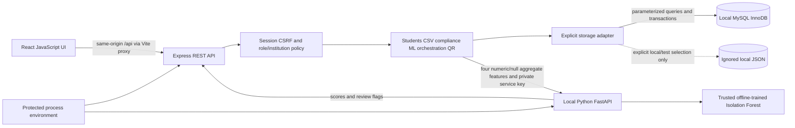
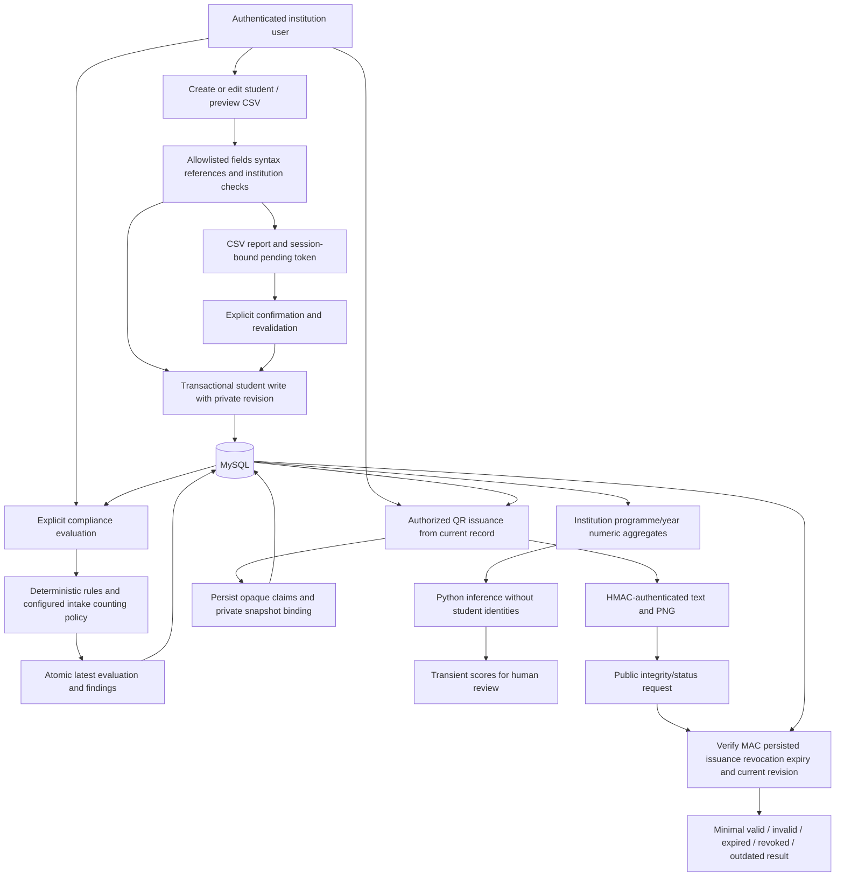
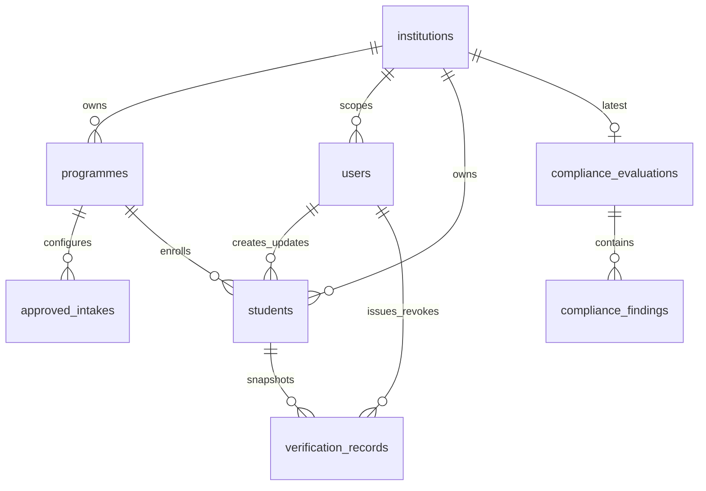

# System architecture and data flow

The implemented SIH26263 prototype is local only. Express owns application persistence; neither React nor Python has database credentials or application-file access.

MySQL failure never selects JSON. Runtime checks the migration ledger before listening. The transaction gate coordinates array-shaped service callbacks across connections; permission/reference rows are locked during related mutations. Network inference happens outside database transactions. [Storage contracts](storage-interface.md) and [schema/migration details](mysql.md) describe the implementation and its limits.

Relevant edits stale saved compliance evaluations and invalidate prior QR snapshots; they do not silently reevaluate, rerun ML or issue a new artifact. CSV preview never writes student rows. All-or-nothing commit rechecks authorization and current references. A name/APAAR never appears in public QR output or the Python request. UI summaries come from actual APIs; missing policy/ML service is not interpreted as a normal result.

The student/programme FK also checks institution ownership. Institution/APAAR and programme/year intake pairs are unique. Foreign keys restrict source deletion; only evaluation replacement cascades to that evaluation's findings. Supporting tables are `schema_migrations`, `storage_mutex`, `json_imports` and `legacy_records`. Dates are UTC, APAAR is text and private edit markers stay outside API field allowlists. Two checksummed SQL migrations are applied explicitly; MySQL DDL is restartable rather than one rollbackable transaction. No schema redesign was introduced for acceptance.
